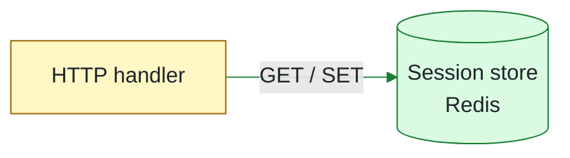

# Pele diagram

[Pele](https://pele.run) is an MIT library from Obsidian that renders Mermaid text to SVG. It has its own layout engine, so its output looks cleaner than GitHub's built-in Mermaid. Pele has no CLI. This skill wraps it in two scripts.

`<skill-dir>` below is the folder that holds this `SKILL.md`.

| Script | What it does |
| --- | --- |
| `<skill-dir>/scripts/pele-render` | Renders `.mmd` files to `.svg`, and with `--png` to `.png` and `.dark.png`. Installs pinned `pele` and `@resvg/resvg-js` into `~/.cache/pele-diagram` on first run. Needs Node 20 or later. |
| `<skill-dir>/scripts/pele-publish` | Pushes rendered files to an image branch in the same GitHub repository and prints image Markdown. Needs `git` and push access. |

## Workflow

1. **Pick the diagram type.** Use `flowchart` for components and calls; it is the only type with diff colors. Use `sequenceDiagram` when the order of calls is the point. Use `architecture-beta` for a deployment picture with icons. See [references/mermaid-cheatsheet.md](references/mermaid-cheatsheet.md).
2. **Write the source** in a scratch directory outside the repository, for example `$TMPDIR/diagrams/<topic>/after.mmd`. Do not commit it to a pull-request branch.
3. **Render and check for errors:**

   ```bash
   <skill-dir>/scripts/pele-render --png <dir>/before.mmd <dir>/after.mmd
   ```

   A syntax error prints `FAIL <file>: syntax at line L, column C` and a caret under the bad token. Fix the source and render again. `--check` validates without writing files.
4. **Look at both PNGs** with your image viewer (the Read tool shows images): `<name>.png` (light) and `<name>.dark.png`. Check that labels fit their boxes, edges do not cross labels, and the change stands out. Act on every `warn:` line. Revise and render again until the diagram is clear. Do not publish a diagram you have not looked at.
5. **Publish** for GitHub (run inside the repository checkout of the pull request):

   ```bash
   <skill-dir>/scripts/pele-publish --json <dir>/before.svg <dir>/after.svg
   ```

   The script prints each image URL with its width and height. Use the SVG files for GitHub: they switch to dark colors in dark mode. Use the PNG files for Slack, docs, and slides.

## Publishing rules

- `pele-publish` writes to an orphan branch (default `pr-diagrams`; set it with `git config --global pele.assetBranch <name>` or `--branch`). The branch never appears in a pull-request diff, and the script does not touch your checkout.
- URLs have the form `https://github.com/<owner>/<repo>/raw/<commit>/<key>/<file>`. GitHub does not proxy `github.com` image URLs, so in a private repository the viewer's own GitHub session loads them. Only people who can read the repository can see the images.
- Never upload a diagram of a private system to a public host (a public repository, a gist, an image-sharing site). The diagram shows internal architecture.
- The default folder (`--key`) is the current branch name. Each publish makes a new commit, so old URLs keep showing the old images.
- The push skips pre-push hooks, because they check the code at `HEAD` of the checkout, not the image commit. Pass `--run-hooks` to run them.

## Make the diagram readable

- Show only what the reader needs: the components that change and one hop of neighbors. Aim for 12 nodes or fewer. Split a bigger picture into two diagrams.
- Name nodes by role in plain words (`Session store`), and add the technology on a second line (`Session store<br/>Redis`) when it matters.
- Label each edge with the call or protocol (`HTTPS`, `publish order.created`, `SQL`). Leave an edge unlabeled only when the meaning is obvious.
- Use `subgraph` for a process, service, or trust boundary. Do not nest more than two levels.
- Keep labels under about 40 characters per line; use `<br/>` to wrap.
- Prefer `flowchart LR`. Switch to `TB` when the render is wider than about 1000 px, because GitHub scales wide images down.

## Show a change

Draw a before diagram and an after diagram with the same node IDs, labels, and direction, so the reader can compare them. Mark only the parts that change, with three reserved classes:

| Class | Meaning | Before diagram | After diagram |
| --- | --- | --- | --- |
| `added` | new node or edge | not present | green |
| `removed` | node or edge that goes away | red, dashed | not present |
| `changed` | same component, new behavior | amber | amber |

Mark a node with `id[Label]:::added`. Mark an edge by giving it an ID and a class:



Keep the `classDef` lines in the source, so it shows the same colors in any other Mermaid renderer (GitHub, mermaid.live). `pele-render` replaces them with theme-aware colors for light and dark mode. Full examples: [examples/before.mmd](examples/before.mmd) and [examples/after.mmd](examples/after.mmd).

## Pele limits

- No HTML labels. Use `<br/>` for line breaks and a Markdown string for bold: ``id["`**Bold** text`"]``.
- `classDef` values must be plain colors; `var(...)` is a syntax error.
- `class` on edges works only for edges that have an ID (`a e1@--> b`).
- Label widths come from a built-in width table, not a real font, so a very long label can overflow its box. The PNG check catches this.
- Icons in `architecture-beta`: `cloud`, `database`, `disk`, `internet`, `server` work without a resolver.
- Limits: 50,000 source characters and 5,000 edges per diagram.
