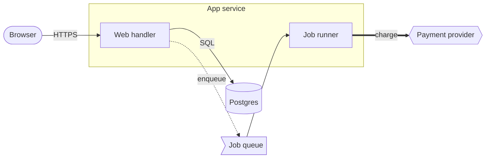
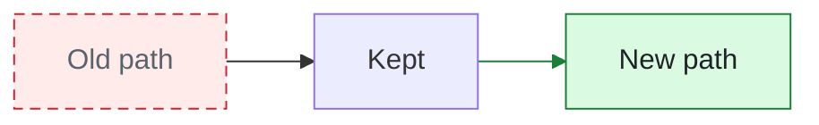
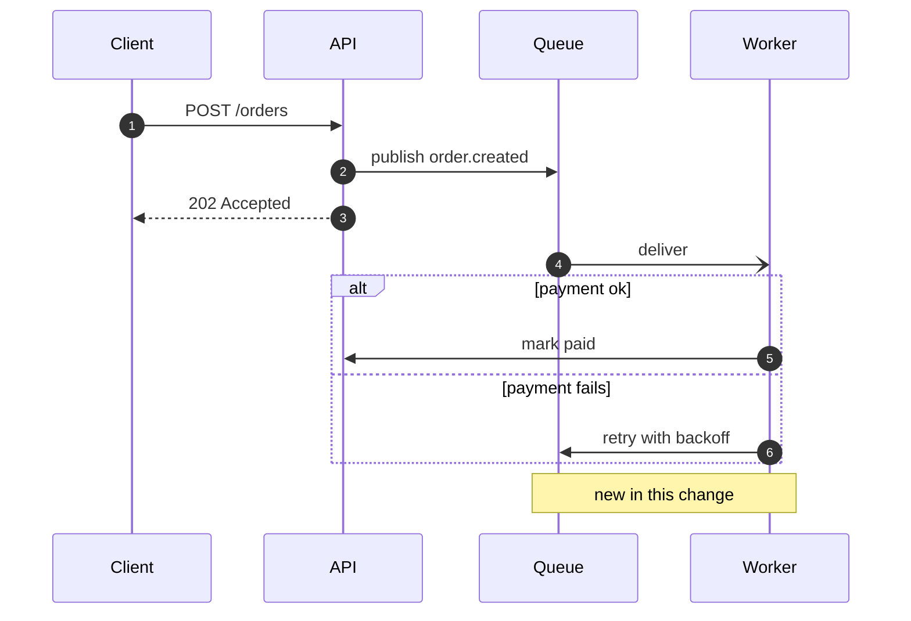
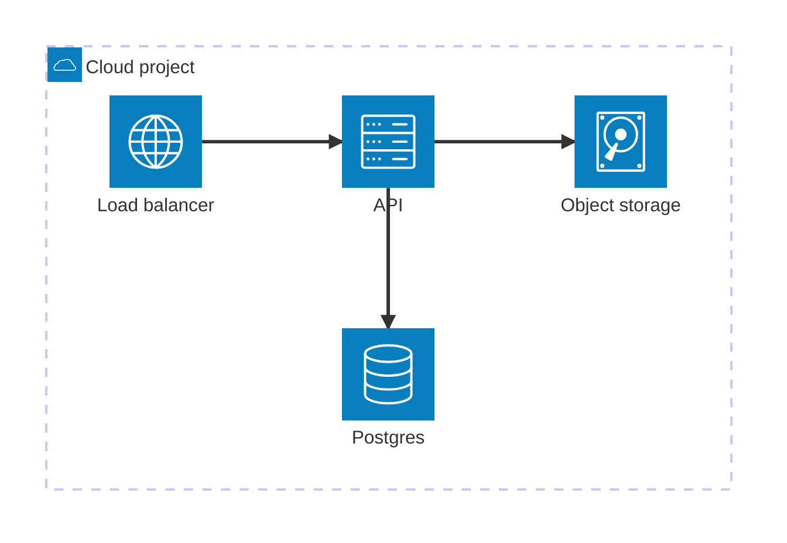

# Mermaid cheat sheet for Pele

Pele supports every diagram type in Mermaid 12.1.0, with its own layout. This page covers the three types that explain systems best. Every block here renders with `pele-render`. Full syntax: <https://mermaid.js.org/intro/>. Pele differences: <https://pele.run/compatibility>.

## Flowchart: components and calls

| Syntax | Meaning |
| --- | --- |
| `flowchart LR` / `TB` | Direction: left to right, top to bottom. `RL` and `BT` also work. |
| `id[Text]` | Box. Other shapes: `([pill])`, `[(cylinder)]`, `{{hexagon}}`, `>flag]`, `((circle))`, `{diamond}`, `[/parallelogram/]` |
| `a --> b` | Call or data flow |
| `a -->|label| b` or `a -- label --> b` | Labeled edge |
| `a -.-> b`, `a -. label .-> b` | Dotted: async, optional, or background |
| `a ==> b` | Thick: the main path |
| `a --- b` | Line without an arrow |
| `a --> b --> c`, `a --> b & c` | Chains and fan-out |
| `subgraph id[Title] ... end` | Group for a service, process, or trust boundary |
| `direction TB` inside a subgraph | Direction for that group only |
| `a e1@--> b` | Edge with an ID, so `class e1 added` can style it |
| `id[Line one line two]` | Line break |
| ``id["`**bold** and _italic_`"]`` | Markdown string label |
| `%% comment` | Comment |

### Classes and styles

- `added`, `removed`, and `changed` are reserved: `pele-render` gives them theme-aware colors. Other class names keep the colors you define, in both light and dark mode.
- `style id fill:#hex,stroke:#hex` styles one node. `linkStyle 0 stroke:#hex` styles an edge by its index (0 is the first edge in the source). Prefer edge IDs; indexes break when edges move.

## Sequence diagram: order and timing

| Syntax | Meaning |
| --- | --- |
| `participant X as Name`, `actor X` | Lifeline (actor draws a person) |
| `A->>B: msg` | Request |
| `A-->>B: msg` | Response |
| `A-)B: msg` | Async message |
| `A-xB: msg` | Failed or dropped message |
| `alt` / `else` / `end`, `opt`, `loop`, `par` / `and`, `critical`, `break` | Blocks |
| `Note over A,B: text`, `Note right of A: text` | Notes |
| `autonumber` | Number the messages |
| `activate A` / `deactivate A` | Activation bar |

Sequence diagrams have no diff classes. To show a change, draw before and after and mark new steps with a `Note` or an `opt` block titled `new`.

## Architecture: deployment picture with icons

| Syntax | Meaning |
| --- | --- |
| `group id(icon)[Title]` | Group; add `in parent` to nest |
| `service id(icon)[Title] in group` | Node with an icon |
| `a:R --> L:b` | Edge from the right side of `a` to the left side of `b` (sides: `T`, `B`, `L`, `R`) |
| `junction id` | Split or join point for edges |
| `align row a b c`, `align column a d` | Force alignment |

Built-in icons: `cloud`, `database`, `disk`, `internet`, `server`. Architecture diagrams have no diff classes; use a flowchart to show a change.
